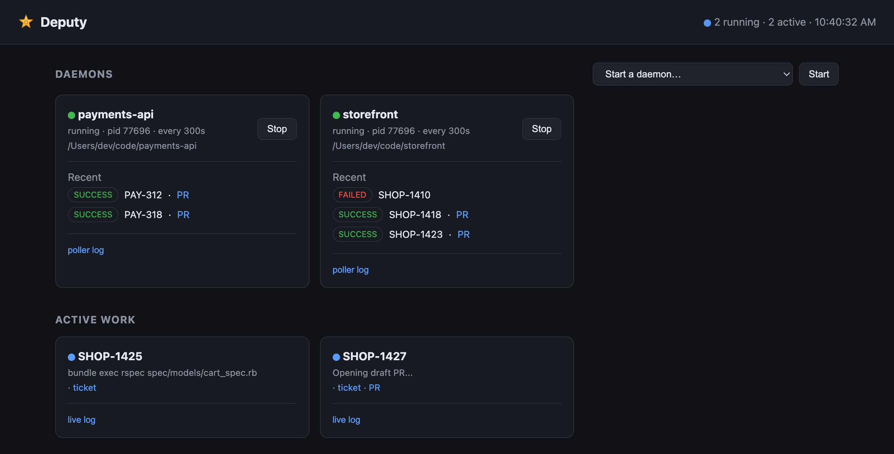
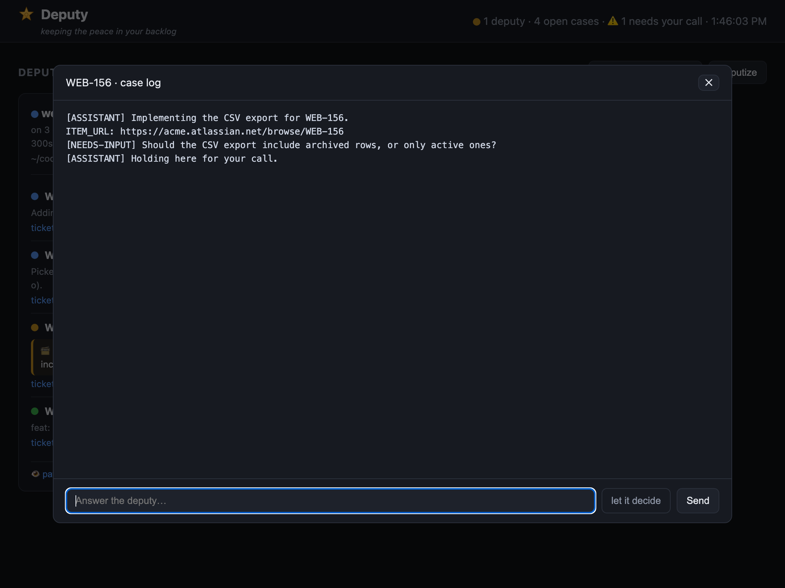
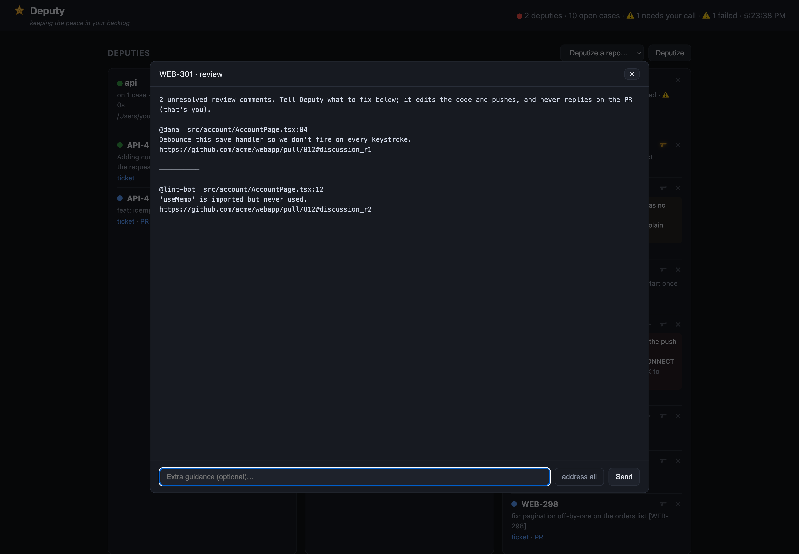
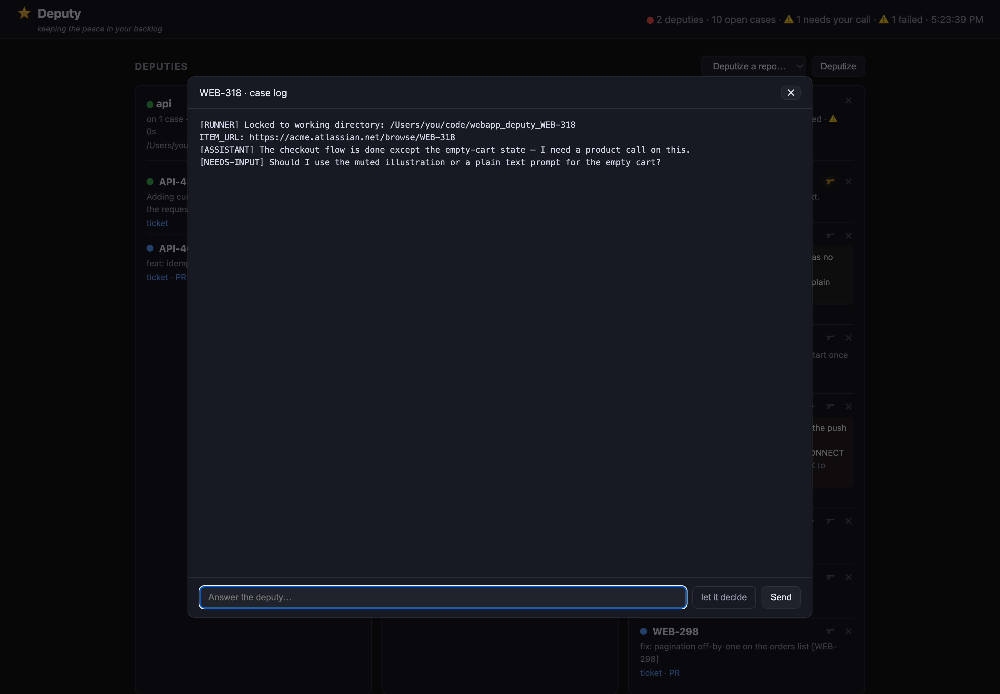
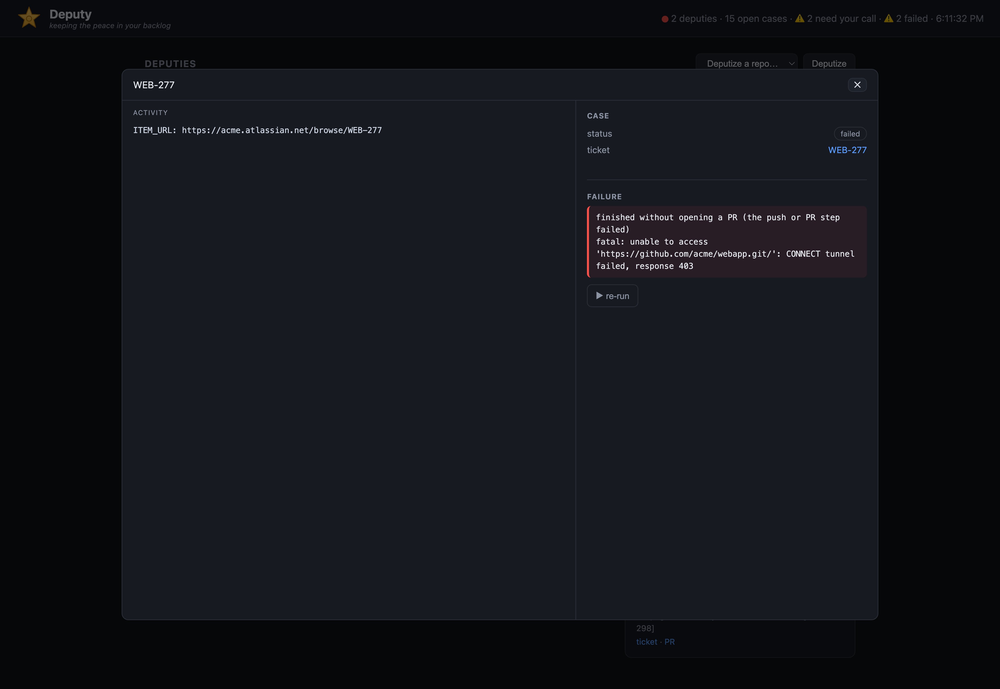
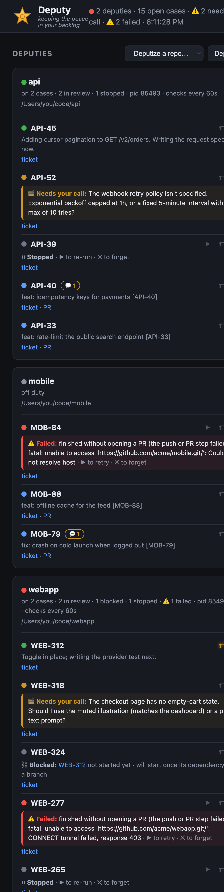

# Deputy

**Point it at your backlog. It ships PRs while you sleep.**

A local daemon that watches a tracker (Jira or GitHub Issues) for ready,
AI-labelled work items and resolves each one autonomously with the
[Claude Agent SDK](https://www.npmjs.com/package/@anthropic-ai/claude-agent-sdk):
isolated git worktree → implement → push → draft PR. Comes with a live web dashboard.



---

## The idea

**You're the sheriff.** You *deputize* a repo and a **deputy** patrols it, watching
for ready tickets. When it finds one it takes the **case** — spins up an isolated
worktree, writes the code, and opens a draft PR. You can watch any deputy work and
**chat with it live** from the dashboard, and it **fixes its own red CI**.

## Why

You label a ticket `ai-ready` and assign it to yourself. A few minutes later there's a
draft PR waiting for review. No copy-pasting tickets into a chat window, no
babysitting. It works autonomously and only pings you ("needs your call") when it
genuinely can't decide something, then resumes on your answer. It runs on your
machine, uses your credentials, and each change lands in its own throwaway git
worktree (or the one you already have open, if you're collaborating).

## What makes it different

Plenty of tools turn an issue into a PR. Deputy's take is specific:

- **Local and yours.** Runs on *your* machine with *your* credentials — no cloud, nothing
  leaving your box, no lock-in. The agent is a swappable command (not tied to Claude) and
  trackers are pluggable.
- **It patrols your real backlog, hands-off.** It watches your tracker and picks up tickets
  labelled **and assigned to you** — you never paste a ticket into a chat window. Label it,
  walk away, come back to a PR.
- **A fleet, not a single chat.** Many repos, many deputies, many cases running at once, in
  one dashboard — not one editor session at a time.
- **It never speaks on your PR.** Review comments (from people *or* bots) are surfaced to
  *you*; Deputy edits the code and pushes, but you stay the only voice on the PR. Most bots
  reply and resolve threads for you — this one deliberately won't.
- **Genuine human-in-the-loop.** It stops to ask when it shouldn't guess and resumes the
  *same* session on your answer, and you can chat with it live mid-run.
- **Dependency-aware stacked PRs.** Hand it a whole epic; it works out the order and stacks
  the PRs, moving sibling tickets in parallel.
- **It won't lose your work.** Cases are journaled, so they resume after a restart, reboot,
  or crash; a run that can't open its PR is recovered by the daemon, never silently dropped.

## Highlights

- **Fully autonomous loop** — poll → isolated worktree → implement → push → draft PR.
- **Fixes its own CI** — watches its PRs; when CI goes red it pulls the failures +
  annotations and pushes a fix automatically.
- **Surfaces review comments, never replies** — watches its open PRs for unresolved
  review comments (people or bots) and flags them on the case with a "💬 N" chip and a
  list (author, `file:line`, link). You tell it what to fix in the reply box; it edits
  and pushes, and posts nothing on the PR. You stay the only voice there. Finished PRs
  stay promptable, so you can send more work after a case is "done."
- **Survives restarts — nothing is lost** — each case's worktree, branch, and live agent
  session are journaled to disk. On a daemon restart, reboot, or crash, Deputy reconnects and
  resumes interrupted cases where they left off. A run that can't open its PR is finished by
  the daemon itself (reliable push outside the agent sandbox); if it truly can't, it shows as a
  red **failed** card instead of vanishing. Stop a case with ✕ and it stays as a **stopped**
  card you can **▶ re-run** anytime. Install the login agent and it even comes back after a reboot.
- **Stops and asks instead of guessing** — when a ticket is ambiguous or needs a
  decision, the deputy parks the case, shows its question ("needs your call"), and
  waits. You answer and it resumes the exact same session (works even after it exits,
  so long waits and reboots are fine). Not every ticket is one-shot, and that's OK.
- **Full-auto when you don't want to be asked** — flip the 🔫 toggle on any case and
  the deputy stops parking for questions; it makes a sensible, reversible decision and
  keeps going. Per-case, off by default.
- **Chat with any deputy live** — open a case and talk to the agent mid-run; it keeps
  full context. Or answer its question (or "let it decide"). No PR/Jira comments.
- **Picks up work you started** — if you already have the ticket's branch open in a
  worktree, the deputy finds it (via the ticket's PR) and works in *your* worktree on
  *your* branch, pushing to the same PR, instead of starting its own. Hit "stop"
  to take the keys back. No branch-naming convention needed.
- **Stacks dependent tickets** — label a whole epic `ai-ready` at once. Each deputy reads
  its ticket's "blocked by" links (or prose): if a dependency has no branch yet the case
  waits (shown **blocked**); once the parent has an open PR, the deputy branches off it and
  opens a **stacked** PR, so siblings move in parallel. It keeps each child rebased as the
  parent branch moves, and rebases onto `main` + retargets the PR when the parent merges —
  handing the rare conflict to the agent to resolve.
- **Pluggable trackers** — Jira and GitHub Issues built in; add another in ~80 lines.
- **Not locked to Claude** — the agent is a swappable command (`DEPUTY_AGENT_CMD`).
- **Isolated by default** — a fresh git worktree per item, off `origin/main` on a
  detached HEAD with its own deps, so your tree is untouched (unless you're
  collaborating on a branch you already have open, see above).
- **Concurrent** — processes multiple items at once, each fully sandboxed.
- **Live dashboard** — deputies on patrol, each ticket shown as one case at its stage
  (working / needs your call / blocked / failed / stopped / in review) with a streaming log,
  live chat, the 🔫 full-auto toggle, ▶ re-run, and one-click deputize / stand down.
- **Zero company lock-in** — all config lives in `.env`; the repo carries no
  secrets and nothing employer-specific. Fork it, point it anywhere.

## Quickstart

```bash
npm install          # for the dashboard (the daemon installs its own runtime deps)
npm run setup        # interactive wizard: tracker + GitHub creds → writes .env, validates
npm run doctor       # verify prerequisites (node/git/gh/jq) + credentials
```

Prefer to do it by hand? `cp .env.example .env` and fill it in — it's self-documenting.

Launch the dashboard:

```bash
npm run dashboard        # http://localhost:4319
```

Then **deputize a repo** — a "deputy" is just the daemon running in one repo (one per repo).
Two equivalent ways to post one:

- **From the dashboard** — add repo paths to `DEPUTY_REPOS` in `.env`, then click **Deputize**
  next to the repo. This just runs the command below for you.
- **From the CLI** — `cd` into any repo and start it directly:

```bash
cd ~/code/my-app
/path/to/deputy/bin/daemon start      # also: stop | status | restart
```

Other commands:

```bash
bin/daemon restart                                          # in-flight cases resume automatically
bin/daemon continue <TICKET> "also handle the empty state"   # follow-up on its PR
bin/daemon stop-ticket <TICKET>                              # stop one case (kept; ▶ re-runnable)
bin/daemon rerun <TICKET>                                   # bring a stopped/failed case back
bin/daemon forget-ticket <TICKET>                           # delete a case + its worktree
bin/daemon autostart-install                                # run at login, survive a reboot
```

### Setup & health check

- **`npm run setup`** — interactive wizard. Pick your tracker, paste your Jira/GitHub
  credentials, and it writes `.env` and confirms it works with a live poll. Prefer to do it
  by hand? `cp .env.example .env` (it's self-documenting).
- **`npm run doctor`** — preflight. Checks `node` ≥18, `git`, `gh` (authenticated), and `jq`,
  that your `.env` has everything the tracker needs, and that a real poll succeeds — printing
  exactly what's missing. Run it any time something seems off.

```
$ npm run doctor
Deputy doctor
  ✓ node (v20.19.4)
  ✓ git
  ✓ jq
  ✓ gh (authenticated)
  ✓ .env present
  ✓ DEPUTY_GITHUB_TOKEN
  ✓ DEPUTY_CLOUD_ID … DEPUTY_SITE_URL
  tracker poll (jira)… ok ✓
All good — run: bin/daemon start
```

## Day to day

1. **Post a deputy** to a repo — `Deputize` it in the dashboard, or `cd <repo> && /path/to/deputy/bin/daemon start`.
2. **Hand it a case** — label a ticket `ai-ready` **and assign it to yourself** (Jira or GitHub Issues), so only your deputy grabs it. It's picked up on the next patrol (≤ `CHECK_INTERVAL`).
3. **Watch it work** — open the dashboard (`npm run dashboard` → http://localhost:4319). The case shows under its deputy with a streaming log.
4. **Steer it live** — open the case and type in the reply box; it answers in the same session.
5. **It finishes on its own** — opens a draft PR (the ticket's status is yours to move). If the PR's CI goes red, it fixes it automatically.
6. **Clear it** — ✕ stops a live case (kept, **▶ re-runnable**), forgets a stopped/failed one, or hides a finished one; the deputy's own ✕ (top-right) stands it down.

## Talking to deputies



Review comments surface on the case, you tell Deputy what to fix, it never replies on the PR
(type a fix, or **address all** at once):



When a case needs a decision it shouldn't make alone, it parks and asks — answer in the same
box, or let it decide:



A run that can't finish (e.g. a push that failed) is **kept and surfaced**, never lost — with
its error and a ▶ to retry:



- **When a deputy needs your call:** if it hits something it shouldn't decide alone,
  it parks the case and surfaces its question (flagged "needs your call" on the
  dashboard). Open the case, answer in the same box, and it resumes right where it
  left off with full context. The session is saved to disk, so it survives the agent
  exiting, long waits, even a reboot. Or from the CLI: `deputy resume <TICKET> "…"`.
- **Live chat:** on the dashboard, open a case and type in the reply box — the
  message streams straight into that running agent's session (full context kept),
  and you watch it think and respond live. The ✕ on a case stops a live agent (keeps
  the worktree) or hides a finished one.
- **Follow-up on an existing PR:** `deputy continue <TICKET> "…"` (or the UI)
  re-checks-out that PR's branch, runs the agent with your note, and pushes to the
  same PR.
- **CI is handled automatically** — when a deputy's PR goes red, it reads the failing
  checks + annotations and pushes a fix without being asked.

## Trackers

Pick where work comes from with `DEPUTY_TRACKER`:

| Tracker  | Polls                                   | on pickup / done                          |
|----------|-----------------------------------------|-------------------------------------------|
| `jira`   | tickets labelled **and assigned to you** | drops the label; status is yours to move  |
| `github` | open issues labelled **and assigned to you** | swaps the ready label for in-progress |

Each tracker is one small module (~80 lines) in
[`lib/trackers/`](lib/trackers/); adding another (Linear, etc.) is covered in
[CONTRIBUTING](CONTRIBUTING.md#adding-a-tracker). The daemon, the agent, and the
dashboard are all tracker-agnostic.

## How it works

```
         ┌──────────── bin/daemon (one per repo) ─────────┐
 tracker │  poll (labelled + assigned to you) ─▶ per item: │
  (Jira/ │                          • git worktree (off main, or a parent branch when stacked)
  GitHub)│                          • run the agent (Claude Agent SDK)
         │                          • push branch, open draft PR          │
         │                          • journal the case so it can resume   │
         └────────────────────────────────────────────────┘
                     ▲                         │ reads /tmp state
                     │ start / stop            ▼
              server/server.mjs  ◀──────  web dashboard (or a future menu bar)
```

The agent reads and updates the tracker through an **in-process MCP server**, so
it never learns the backend. The dashboard and control API are decoupled from the
daemon (the API reads `/tmp` state and shells out), so any front-end can reuse the
same endpoints. Full internals, state layout, and gotchas live in
[CONTRIBUTING](CONTRIBUTING.md).

## Configuration

Needs `node` ≥18, `git`, `gh` (authenticated), and `jq`. The daemon installs its
own agent deps into `<repo>_deputy/` on first start.

Everything is driven by `DEPUTY_*` variables in `.env` — see
[`.env.example`](.env.example) for the full list. Required: tracker credentials +
a GitHub token. Notable knobs:

- `DEPUTY_TRACKER` — `jira` | `github`
- `DEPUTY_REPOS` — repo paths the dashboard can deputize (one daemon per repo)
- `DEPUTY_WORKTREE_SETUP` — command run in each fresh worktree, e.g. `bundle install && yarn install` (so tests/hooks pass)
- `DEPUTY_AGENT_CMD` — the agent command; defaults to the bundled Claude runner, swap for any other
- `DEPUTY_PR_LABEL` — label put on deputy PRs (also how CI auto-fix finds them)

## On your phone, too

The dashboard is responsive, so you can check on your deputies (and answer a "needs your
call") from a phone browser.



## Try it with mock data

Want to see the whole board without wiring up a tracker? Seed a fake one:

```bash
npm run demo        # mock deputies + every case state → http://localhost:4320
```

That writes a self-contained demo state (generic repos/tickets, no real agents) — handy for
a look around or for screenshots. Stop the helper processes with `bin/seed-demo --stop`.

## Contributing

Architecture, local dev, the test suite, and hard-won gotchas are in
[CONTRIBUTING](CONTRIBUTING.md). Run the tests with `npm test`.
