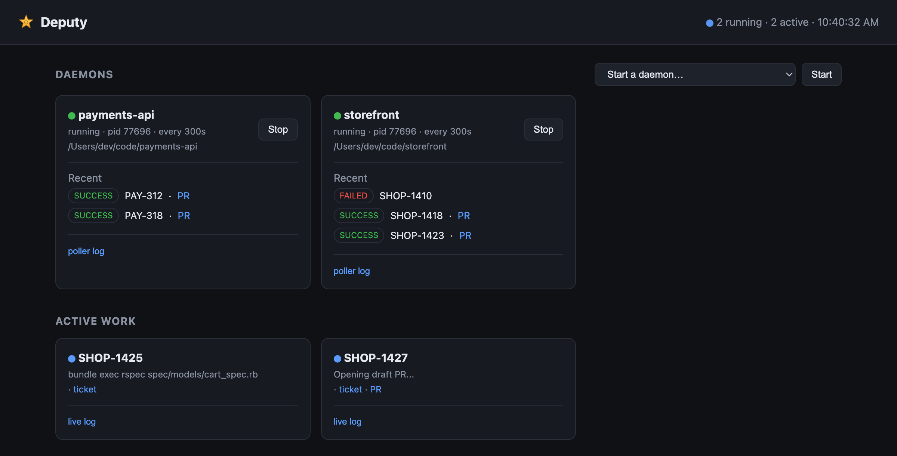
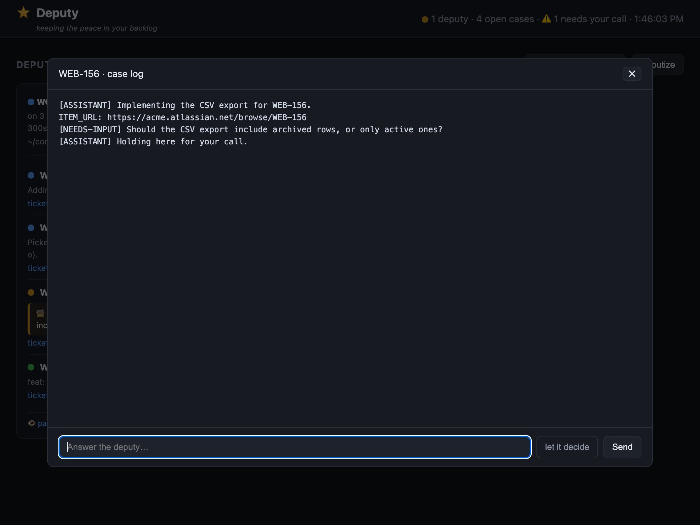
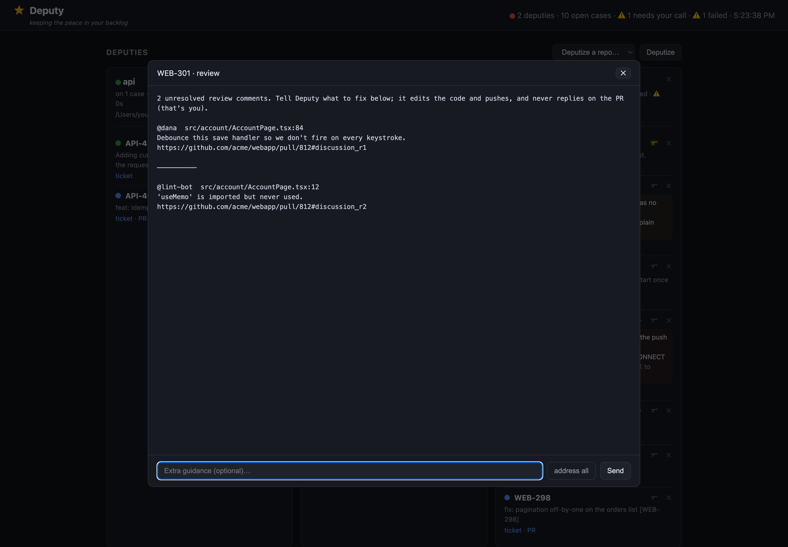
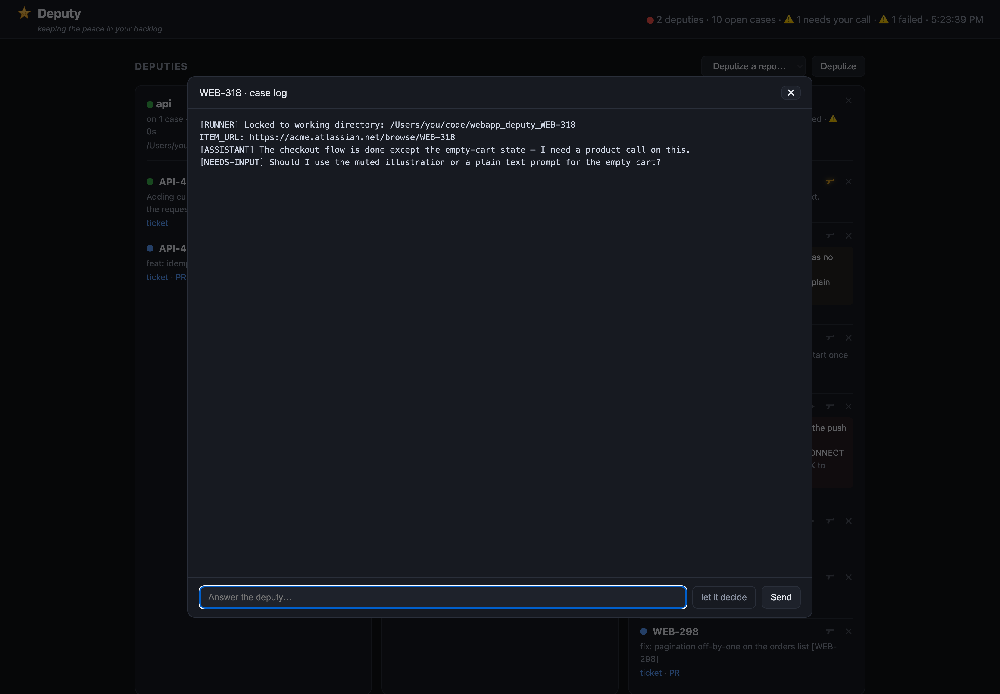
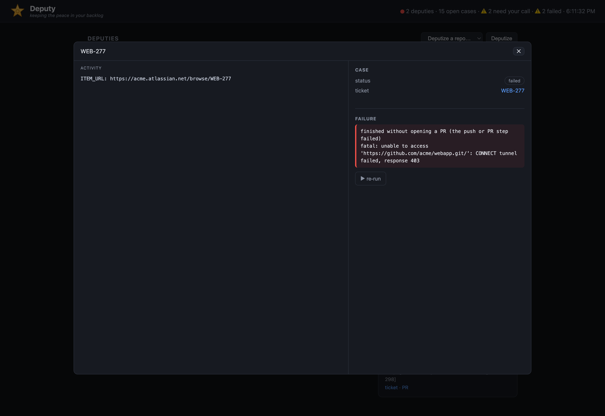

# Deputy

[](https://github.com/jonshaw199/deputy/actions/workflows/test.yml)
[](LICENSE)

**Point it at your backlog. It ships PRs while you sleep.**

A local daemon that watches a tracker (Jira or GitHub Issues) for ready,
AI-labelled work items and resolves each one autonomously with the
[Claude Agent SDK](https://www.npmjs.com/package/@anthropic-ai/claude-agent-sdk):
isolated git worktree → implement → push → draft PR. Comes with a live web dashboard.



## How it feels

You label a ticket `ai-ready` and assign it to yourself. A few minutes later a **deputy**
has taken the **case** — spun up an isolated worktree, written the code, and opened a draft
PR. No pasting tickets into a chat window, no babysitting. It works autonomously and only
pings you ("needs your call") when it genuinely can't decide, then resumes on your answer.
Everything runs on your machine, with your credentials.

## What makes it different

Plenty of tools turn an issue into a PR. Deputy's take is specific:

- **Local and yours.** Runs on your machine with your credentials — no cloud, no lock-in.
  The agent is a swappable command (opencode, aider, …) and trackers are pluggable; nothing
  is hard-tied to Claude.
- **A fleet, not a chat.** Many repos, many deputies, many cases at once in one dashboard —
  not one editor session at a time.
- **It never speaks on your PR.** Review comments (people *or* bots) are surfaced to *you*;
  Deputy edits the code and pushes, but you stay the only voice on the PR.
- **It won't lose your work.** Cases are journaled and resume after a restart, reboot, or
  crash; a run that can't open its PR is recovered by the daemon, never silently dropped.

## Key features

- **Autonomous loop** — poll → isolated worktree → implement → push → draft PR, many items
  at once, each fully sandboxed.
- **Fixes its own CI** — watches its PRs; when one goes red it pulls the failures +
  annotations and pushes a fix without being asked.
- **Verifies before it ships** — a separate skeptical pass checks the work against the
  ticket's acceptance criteria (grounded in the real diff) and sends the builder back to
  close any gaps before the PR is called done.
- **Keeps PRs clean + mergeable** — drops stray setup/test drift that isn't the ticket's work
  (a regenerated schema dump, a lockfile), rebases a branch that fell behind its base, and
  hands a real conflict to the agent to resolve.
- **One board, many repos** — several repos can share one tracker board; each deputy
  self-selects whether a ticket belongs to its repo (or you pin it with a `Repos:` line), so
  the right one(s) claim it and none grabs another repo's work. A ticket that spans repos is
  built as one slice per repo, and each deputy keeps its slice consistent with its siblings on
  what they share (an API path, a payload shape, field casing). See **Writing a ticket**.
- **Surfaces review comments** — flags unresolved comments on the case (a `💬 N` chip +
  author / `file:line` / link); you say what to fix, it edits and pushes, and posts nothing
  on the PR. Finished PRs stay promptable, so you can send more work after a case is "done."
- **Parks and asks** — on an ambiguous ticket it shows its question ("needs your call") and
  waits; answer and it resumes the exact session (survives the agent exiting, long waits,
  reboots). Flip the 🔫 full-auto toggle on a case to make it decide for itself instead.
- **Warm follow-up chat** — messages stream into a live agent's session, and a finished case
  **resumes its saved session** (it remembers everything) rather than starting cold.
- **Test locally, then take over** — a case's worktree is **kept** after it finishes so you
  can `cd` in and run the PR; **Open in editor** drops the case into your editor (VS Code +
  Claude Code by default), resuming the agent's conversation. Pruned when the PR merges.
- **Follows your repo** — reads the repo's `CLAUDE.md` / conventions and fills out its PR
  template.
- **Reuses a branch you've started** — if the ticket's branch is already checked out in a
  worktree, the deputy works there and pushes to the same PR instead of starting its own.
- **Dependency-aware stacked PRs** — label a whole epic at once; each deputy reads its
  "blocked by" links, waits (shown **blocked**) until a dependency has a branch, then stacks
  its PR on the parent. Children stay rebased as parents move, and rebase onto `main` +
  retarget when the parent merges — handing the rare conflict to the agent.
- **Survives restarts** — worktree, branch, and session are journaled; the daemon reconnects
  and resumes interrupted cases, finishes a stuck PR itself, and shows a red **failed** card
  instead of vanishing. Install the login agent and it even comes back after a reboot.

## Quickstart

```bash
npm install          # dashboard deps (the daemon installs its own runtime deps)
npm run setup        # wizard: tracker + GitHub creds → writes .env, validates with a live poll
npm run doctor       # preflight: node ≥18 / git / gh (authenticated) / jq + credentials
npm run dashboard    # http://localhost:4319
```

Prefer to do it by hand? `cp .env.example .env` — it's self-documenting.

Then **deputize a repo** (a deputy is just the daemon running in one repo). Click
**Deputize** in the dashboard after adding paths to `DEPUTY_REPOS`, or from the CLI:

```bash
cd ~/code/my-app && /path/to/deputy/bin/daemon start   # also: stop | status | restart
```

Other verbs:

```bash
bin/daemon continue <TICKET> "…"    # follow up on its PR (warm-resumes the session)
bin/daemon stop-ticket <TICKET>     # halt a case (kept, ▶ re-runnable)
bin/daemon rerun <TICKET>           # bring a stopped/failed case back
bin/daemon forget-ticket <TICKET>   # delete a case + its worktree
bin/daemon autostart-install        # run at login, survive a reboot
```

## Day to day

1. **Hand it a case** — label a ticket `ai-ready` **and assign it to yourself** (so only
   your deputy grabs it); it's picked up on the next patrol.
2. **Watch and steer** — open the case in the dashboard for a streaming log, and type in the
   reply box to talk to the agent live in the same session.
3. **It finishes on its own** — opens a draft PR (the ticket's status is yours to move) and
   fixes its own red CI. Test the PR from its kept worktree, or **Open in editor** to take over.
4. **Clear it** — ✕ stops a live case (kept, **▶ re-runnable**), forgets a stopped/failed
   one, or hides a finished one.

## Writing a ticket

A deputy picks up a ticket when it is **labelled `ai-ready`** and **assigned to you** (your
tracker user). That is the whole contract: write the title and description like any ticket,
and the clearer the acceptance criteria, the better the PR (the verify pass checks the work
against them). The label is removed on pickup so it is never grabbed twice; the status stays
yours to move.

**One board, many repos.** Several repos can share one board. Before working a ticket each
deputy checks, grounded in its own checkout, whether the work belongs in its repo, so the
right one(s) claim it and no deputy grabs another repo's work.

**Pin the repo(s) to skip the guess.** Add one line to the ticket body:

```
Repos: my-api, my-web
```

Each listed repo claims its slice; the rest skip. One name is a normal single-repo case; two
or more makes it a cross-repo ticket (below). Use the GitHub repo name or the checkout folder
name. Leave the line out and the deputy decides for itself.

**Cross-repo tickets.** When a ticket spans repos, each repo builds its own slice as its own
PR. Because the slices are built independently, each deputy also checks that its slice agrees
with its siblings on what they share (an API path, a payload shape, field casing, an enum) and
fixes only its own side if it drifted. The dashboard groups the slices as one ticket and flags
any slice still waiting on a sibling repo.

## Talking to deputies

Open a case to chat mid-run; review comments surface for you to triage (type a fix, or
**address all**); and when a case needs a decision it shouldn't make alone, it parks and asks.
A run that can't finish is kept and surfaced with its error and a ▶ to retry — never lost.






## Trackers

Pick where work comes from with `DEPUTY_TRACKER`:

| Tracker  | Polls                                        | on pickup / done                         |
|----------|----------------------------------------------|------------------------------------------|
| `jira`   | tickets labelled **and assigned to you**     | drops the label; status is yours to move |
| `github` | open issues labelled **and assigned to you** | swaps the ready label for in-progress    |

Each tracker is one small module (~80 lines) in [`lib/trackers/`](lib/trackers/); adding
another (Linear, etc.) is covered in [CONTRIBUTING](CONTRIBUTING.md#adding-a-tracker). The
daemon, the agent, and the dashboard are all tracker-agnostic.

## How it works

```
         ┌──────────── bin/daemon (one per repo) ─────────┐
 tracker │  poll (labelled + assigned to you) ─▶ per item: │
  (Jira/ │                          • git worktree (off main, or a parent branch when stacked)
  GitHub)│                          • run the agent (Claude Agent SDK, or any DEPUTY_AGENT_CMD)
         │                          • push branch, open draft PR          │
         │                          • journal the case so it can resume   │
         └────────────────────────────────────────────────┘
                     ▲                         │ reads /tmp state
                     │ start / stop            ▼
              server/server.mjs  ◀──────  web dashboard
```

The daemon never calls Claude directly — it runs `DEPUTY_AGENT_CMD` and talks to it only
through env vars, files, and stdout, so any agent that speaks the
[runner protocol](CONTRIBUTING.md#swapping-the-agent-runner-protocol) can replace it. The
agent reads and updates the tracker through an in-process MCP server, so it never learns the
backend. The dashboard reads `/tmp` state and shells out, so any front-end can reuse the API.

## Configuration

Needs `node` ≥18, `git`, `gh` (authenticated), and `jq`. Everything is driven by `DEPUTY_*`
variables in `.env` — see [`.env.example`](.env.example) for the full, self-documenting list.
Required: tracker credentials + a GitHub token. Notable knobs:

- `DEPUTY_TRACKER` — `jira` | `github`
- `DEPUTY_REPOS` — repo paths the dashboard can deputize (one daemon per repo)
- `DEPUTY_AGENT_CMD` — the agent command; defaults to the bundled Claude runner, swap for any other
- `DEPUTY_WORKTREE_SETUP` — run in each fresh worktree, e.g. `bundle install && yarn install`
- `DEPUTY_TEST_SETUP` — heavier setup to make a *kept* worktree runnable (e.g. `bin/update`), run after a case finishes
- `DEPUTY_OPEN_CMD` — custom "Open in editor" handoff; gets `$DEPUTY_WORKTREE` + `$DEPUTY_SESSION`
- `DEPUTY_PR_LABEL` — label put on deputy PRs (also how CI auto-fix finds them)
- `DEPUTY_VERIFY` — skeptical verify-before-ship pass (on by default; `DEPUTY_VERIFY_MAX` caps retries)
- `DEPUTY_RELEVANCE` — at finish, drop changed files that aren't the ticket's work (on by default)
- `DEPUTY_FRESHEN` / `DEPUTY_FRESHEN_MAX_DAYS` — rebase open PRs that fall behind their base
- `DEPUTY_CONTRACT_VERIFY` / `DEPUTY_CONTRACT_FIX_MAX` — keep cross-repo slices consistent

## Try it with mock data

```bash
npm run demo        # mock deputies + every case state → http://localhost:4320
```

A self-contained demo state (generic repos/tickets, no real agents) — handy for a look around
or for screenshots. Stop the helper processes with `bin/seed-demo --stop`.

## Contributing

Architecture, the [runner protocol](CONTRIBUTING.md#swapping-the-agent-runner-protocol) for
swapping in another agent, local dev, the test suite, and hard-won gotchas are in
[CONTRIBUTING](CONTRIBUTING.md). Run the tests with `npm test`.
